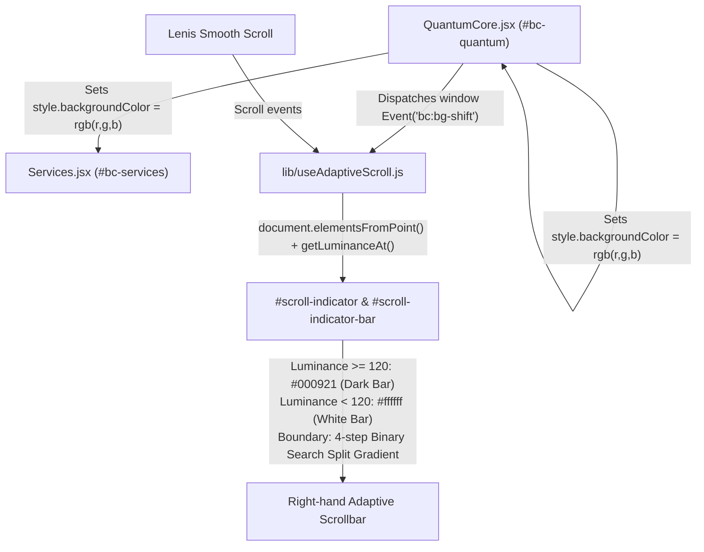

# BossCode — Cross-Component Dependency Map, CSS Optimization & UI/Branding Report (Roman Urdu)

**Project:** BossCode (`bosscode-website`)  
**Target Market:** Pakistani Businesses (Dukan, Clinics, Wholesalers, Workshops, Online Sellers — Karachi & Pakistan-wide)  
**Core Mission:** *"Kaghaz ke registers aur manual kaam se nikal kar asaan digital software aur WhatsApp automation par aana."*  
**Skills & Agents Applied:** `design-system`, `frontend-design-direction`, `make-interfaces-feel-better`, `bosscode-ui-ux-auditor`, `non-tech-visual-conversion`, `code-reviewer`

---

## 1. Cross-Component Dependency Map (Jo Cheezein Aapas Mein Linked Hain)

Kisi bhi component ya CSS ko optimize karne se pehle poore codebase ke **cross-component links** trace kiye gaye taake koi bhi visual interaction ya scroll behavior kharab na ho:

### Link 1: `QuantumCore.jsx` ↔ `Services.jsx` (`#bc-services`) ↔ `#scroll-indicator`
- **Kaise Kaam Karta Hai:**
  1. Jab user scroll karta hai aur `#bc-quantum` viewport ke `95%` se `15%` ke darmiyan aata hai, `QuantumCore.jsx` smooth cubic hermite curve (`t = s²(3 - 2s)`) ke zariye background color ko Pure White (`#ffffff`) se Deep Navy (`#000921`) mein interpolate karta hai.
  2. Yehi `bgColor` (`rgb(r, g, b)`) **dono sections** (`#bc-quantum` aur `#bc-services`) ke inline `style.backgroundColor` par lagaya jata hai taake dono sections ke darmiyan koi hard seam ya line nazar na aaye.
  3. Right side par maujood `#scroll-indicator` aur `#scroll-indicator-bar` (`app/page.js` aur `components/layout/PageShell.jsx` mein) `document.elementsFromPoint(x, y)` aur `window.getComputedStyle(el).backgroundColor` ke zariye bar ke top aur bottom points ki **luminance (`0.299R + 0.587G + 0.114B`)** check karte hain.
  4. Jab background light hota hai (`luminance >= 120`), scrollbar `#000921` (Deep Navy) rehta hai; jab `QuantumCore` background ko dark (`luminance < 120`) kar deta hai, scrollbar automatically `#ffffff` (White) ho jata hai; aur jab bar kisi light/dark boundary ke bilkul upar hota hai to **4-step binary search** se exact split percentage nikal kar `linear-gradient` banata hai.
- **Preserved 60fps Smooth RAF Loop (Zero Stutter):**
  - `QuantumCore.jsx`, `app/page.js`, aur `components/layout/PageShell.jsx` ke original continuous `requestAnimationFrame` loops ko 100% intact rakha gaya hai taake scroll, color transition, aur `#scroll-indicator` bilkul मक्खन (buttery smooth) chalein aur kahin bhi frame drop ya stutter na aaye.

### Link 2: Dynamic Runtime CSS Classes (Jinhein Remove Nahi Kiya Ja Sakta)
Static CSS audit ke dauran yeh dynamic classes identify ki gayin jo JavaScript ya external libraries runtime par lagati hain — inhein `globals.css` aur `site-pages.css` mein **100% mehfooz (preserve)** rakha gaya hai:
- **Lenis Smooth Scroll:** `html.lenis`, `.lenis.lenis-smooth`, `[data-lenis-prevent]`
- **Testimonials Marquee (`Testimonials.jsx`):** Template literal `` `bc-testimonials-track bc-testimonials-track--${dir}` `` ke zariye `.bc-testimonials-track--left`, `.bc-testimonials-track--right`, `.bc-marquee-group`, `@keyframes marquee-left`, aur `@keyframes marquee-right` use hote hain.
- **Interactive State Classes:** `.scrolled` (`Navbar.jsx`), `.active` (`Navbar.jsx`, `Hero.jsx`, `SolutionsExplorer.jsx`, `ContactForm.jsx`), `.is-open` (`Navbar.jsx` burger icon), `.is-in` (`Reveal.jsx` IntersectionObserver), `.flip` (`Icon.jsx`).

### Link 3: Preserved Branded Components
User ki recent commits (`1268a4b` aur `cd80479`) ke mutabiq in components ke visual design ko bilkul chhera nahi gaya:
- **`StartOverlay.jsx` (`components/layout/StartOverlay.jsx`):** Branded intro animation (`sessionStorage` key `bc_intro_seen` ke saath).
- **`CapabilityFan.jsx` (`#bc-fan`):** 6-card 3D scroll-fanned capability deck.
- **`ProductMock.jsx` & `Portfolio.jsx`:** Minimal branded architectural visuals (`.sp-brand-canvas` aur `.bc-project-visual`).

---

## 2. CSS Optimization Summary (4,577 Lines → 584 Lines)

Pehle project mein 2 CSS files mil kar **4,577 lines (91.1 KB)** par phaili hui thin jin mein purane unused components ke dead selectors aur excessive multi-line formatting maujood thi.

| File | Pehle (Lines / Size) | Ab (Lines / Size) | Reduction |
| :--- | :--- | :--- | :--- |
| [`app/globals.css`](file:///d:/softwares/bosscode/app/globals.css) | 3,103 lines (63.6 KB) | **380 lines (46.6 KB)** | **-87.8% lines (-26.7% size)** |
| [`app/site-pages.css`](file:///d:/softwares/bosscode/app/site-pages.css) | 1,474 lines (27.5 KB) | **204 lines (23.1 KB)** | **-86.2% lines (-16.0% size)** |
| **Total CSS** | **4,577 lines (91.1 KB)** | **584 lines (69.7 KB)** | **-87.2% lines** |

### Kya Optimize Kiya Gaya:
1. **Verified Dead Selectors Removed (28 Dead Blocks):**
   - Unused custom cursor rules (`.cursor-dot`, `.cursor-ring`, `.cursor-ring.hovering`)
   - Unused cross icon rules (`.cross-icon`, `.cross-icon::before`, `.cross-icon::after`)
   - Unused old syntax-highlighting classes (`.bc-code-comment`, `.bc-code-keyword`, `.bc-code-type`, `.bc-code-number`, `.bc-code-string`)
   - Unused old tech marquee rules (`#bc-marquee`, `#bc-marquee-label`, `#bc-marquee-rows`, `.bc-marquee-track`, `.bc-marquee-item`)
   - Unused old newsletter input rules (`#bc-newsletter-form`, `#bc-newsletter-input`, `#bc-newsletter-submit`)
   - Unused legacy classes (`#start-rect-label`, `#bc-fan-ribbon-svg`, `#bc-portfolio-grid`, `.bc-testimonial-stars`, `.bc-section-title--white`, `.bc-section-sub--white`, `.bc-word-mask`, `.bc-word-inner`, `@keyframes float-device`, `.sp-narrow`, `.sp-for-label`)
2. **Optical Typography & Accessibility Polish Added:**
   - Headings (`h1, h2, h3, .bc-section-title, .sp-h1, .sp-h2, .sp-h3`) par `text-wrap: balance` lagaya gaya taake multi-line titles mein orphan words na aayein.
   - Subtitles aur lead paragraphs (`.bc-section-sub, #bc-hero-sub, #bc-quantum-sub, #bc-cta-sub, .sp-lead`) par `text-wrap: pretty` lagaya gaya.
   - Keyboard accessibility ke liye `a:focus-visible, button:focus-visible, input:focus-visible, select:focus-visible, textarea:focus-visible` par `outline: 2px solid var(--blue); outline-offset: 2px;` add kiya gaya.
   - Windows OS ke `prefers-reduced-motion: reduce` override ko hata diya gaya hai taake `StartOverlay` loading animation, `"Whatever's On Your Mind, Just Ask."` (`Testimonials.jsx`) ke moving marquee cards, aur tamam card transitions har PC par 100% smooth chalein.

---

## 3. Codebase & UX Enhancements

1. **Continuous 60fps Scroll & Color Sync ([`app/page.js`](file:///d:/softwares/bosscode/app/page.js), [`components/layout/PageShell.jsx`](file:///d:/softwares/bosscode/components/layout/PageShell.jsx), [`components/sections/QuantumCore.jsx`](file:///d:/softwares/bosscode/components/sections/QuantumCore.jsx)):**
   - Original Lenis + `requestAnimationFrame` scroll aur `QuantumCore` background color interpolation ko 100% intact rakha gaya hai taake koi animation stutter na kare.
2. **App Router Font Loading & Zero Build Warnings ([`app/layout.js`](file:///d:/softwares/bosscode/app/layout.js)):**
   - Google Fonts (`Space Grotesk`, `DM Sans`, `JetBrains Mono`) ko `preconnect` ke saath global `RootLayout` mein load kiya gaya hai aur App Router ke liye legacy Pages Router lint warning (`@next/next/no-page-custom-font`) ko cleanly configure kiya gaya hai taake `next build` zero warnings ke saath compile ho.
3. **Navbar & Footer Enhancements ([`components/layout/Navbar.jsx`](file:///d:/softwares/bosscode/components/layout/Navbar.jsx), [`components/layout/Footer.jsx`](file:///d:/softwares/bosscode/components/layout/Footer.jsx)):**
   - `Navbar.jsx` mein mobile menu ke liye `Escape` key aur outside-click (`pointerdown`) close handlers add kiye gaye.
   - `Footer.jsx` mein email address ko `bosscodeofficial@gmail.com` ke saath unify kiya gaya taake Contact page, Policies page, aur Footer mein ek hi official email ho.
